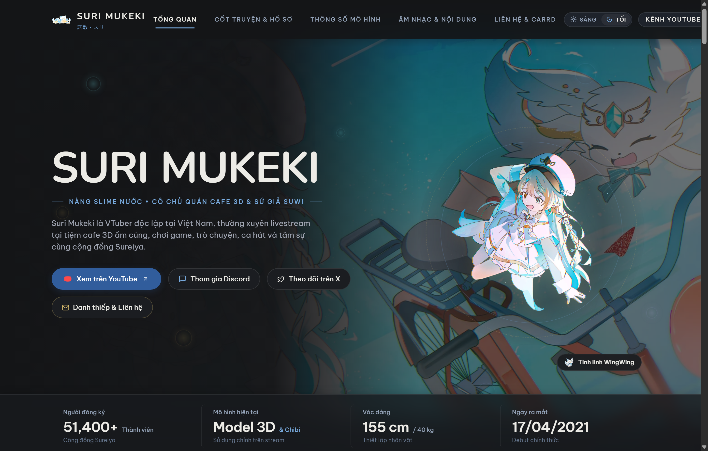
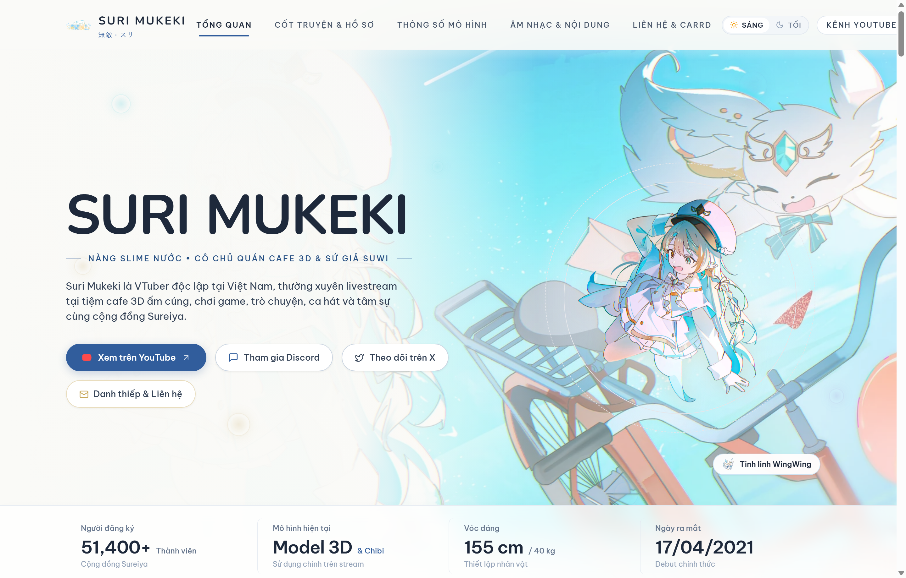
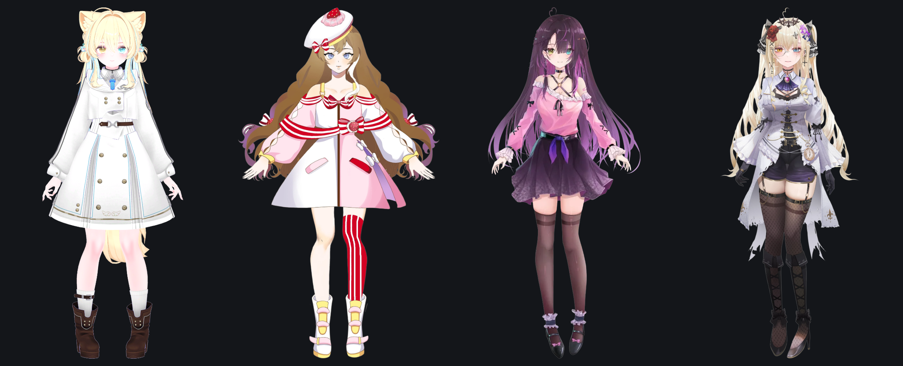
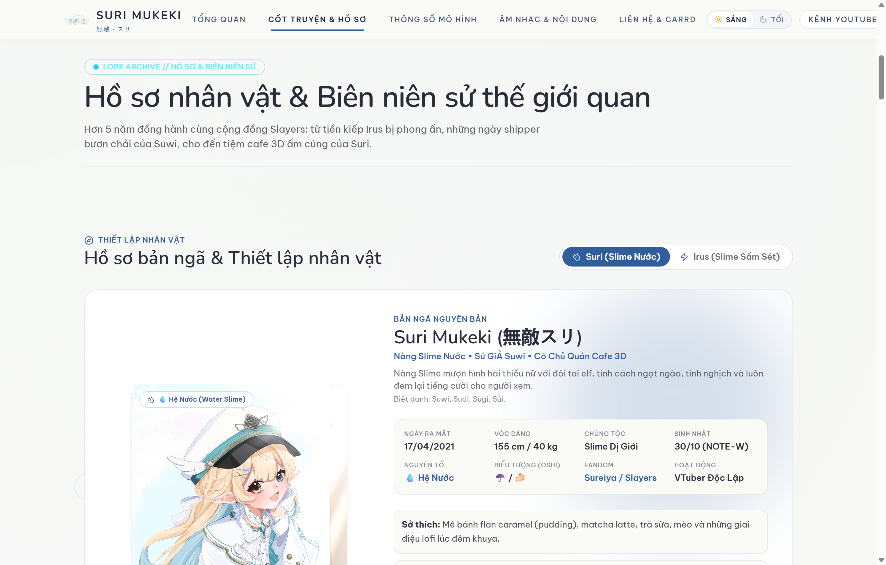
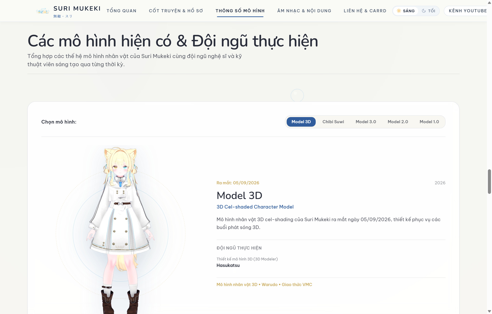
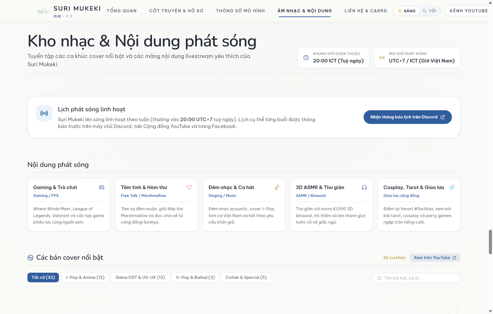
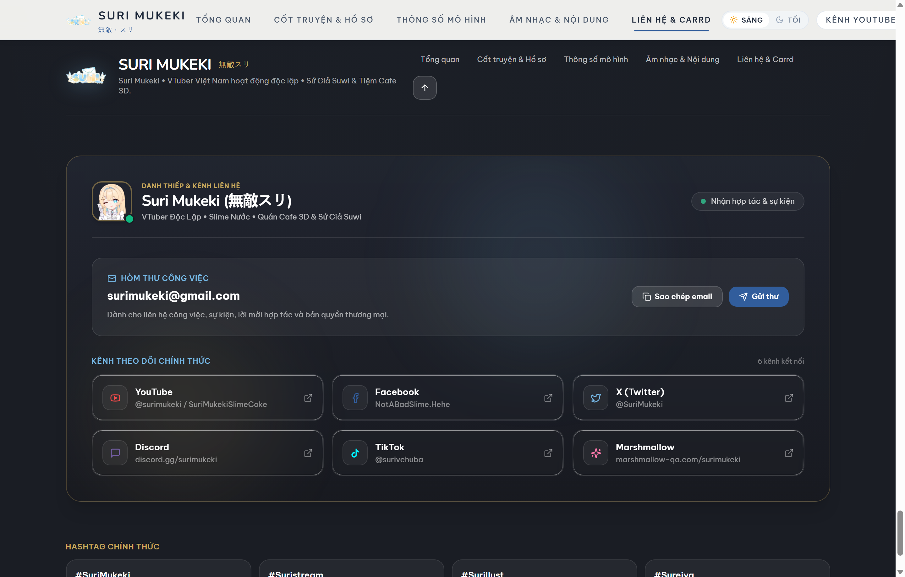
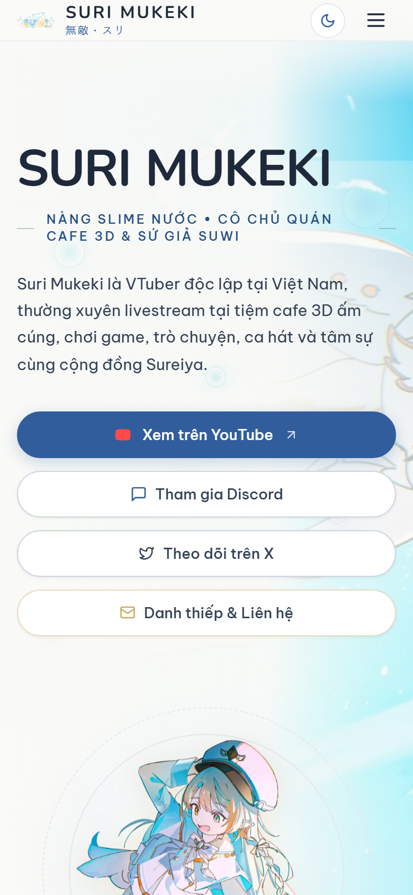
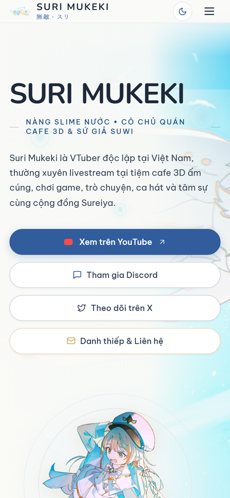

# Suri Mukeki — Official Character Showcase & VTuber Portfolio

[](CHANGELOG.md)
[](LICENSE)
[](scripts/test-runner.cjs)
[](scripts/test-runner.cjs)
[](https://react.dev/)
[](https://www.typescriptlang.org/)
[](https://vitejs.dev/)
[](https://tailwindcss.com/)

An interactive, high-performance web portfolio and character showcase for Vietnamese independent Virtual YouTuber **Suri Mukeki** (無敵・スリ).

Built with a **Candy Pop Anime &times; Japanese Motion Graphics** design language, the website delivers an immersive single-page experience featuring a dual light/dark theme engine, interactive model inspection decks, lore chronicles, broadcast routines, verified cover music theater, and a multi-channel contact card.

---

## 📸 Visual Previews

### Dual Light / Dark Theme Engine
Switch seamlessly between a high-contrast cinematic dark aesthetic and a clean Japanese paper editorial light aesthetic.

| Dark Mode (Cinematic) | Light Mode (Editorial) |
| :---: | :---: |
|  |  |

---

### Character Model Lineage & 3D Evolution
Comprehensive lineage tracking from Genesis Model 1.0 (2021) to the Cel-shaded 3D Model debut (Sept 2026).



---

### Showcase Sections Overview

| Lore & Chronicle Codex | Model Telemetry & Specs Deck |
| :---: | :---: |
|  |  |
| **Broadcast Schedule & Cover Music Theater** | **Contact Card & Official Community Links** |
|  |  |

---

### Mobile Viewport & Navigation Drawer
Responsive design optimized for zero horizontal overflow across all mobile screens.

| Mobile Hero Stage | Mobile Navigation Drawer |
| :---: | :---: |
|  |  |

---

## Table of Contents

- [What the Project Does](#what-the-project-does)
- [Why the Project Is Useful](#why-the-project-is-useful)
- [Architecture & Tech Stack](#architecture--tech-stack)
- [Getting Started](#getting-started)
  - [Prerequisites](#prerequisites)
  - [Installation](#installation)
  - [Development Server](#development-server)
  - [Building for Production](#building-for-production)
  - [Testing & Quality Verification](#testing--quality-verification)
- [Project Structure](#project-structure)
- [Configuration & Customization](#configuration--customization)
- [Support & Documentation](#support--documentation)
- [Maintainers & Contributing](#maintainers--contributing)
- [Credits & Acknowledgments](#credits--acknowledgments)
- [License](#license)

---

## What the Project Does

The **Suri Mukeki Showcase** serves as both an official fan tribute portfolio and an interactive digital business card (Contact Card) for Suri Mukeki. The application provides:

1. **Cinematic Hero Presentation**: A hero introduction with dynamic badge telemetry, staggered typography reveals, character cutouts, and fast-action social links.
2. **Interactive Lore & Chronicle Codex**: An editorial story section documenting Suri's genesis as a reincarnated water slime, the enigmatic letter from "W", the 300-year lightning seal on her alter persona *Irus*, and her sovereign rebirth.
3. **Model Evolution Deck & 3D Showcase**: Technical telemetry and model evolution inspector covering her 3D Cel-shaded model (debuted Sept 2026), Chibi Suwi, Model 3.0 Live2D, Model 2.0, and Genesis Model 1.0.
4. **Broadcast Schedule & Music Sessions**: Real-time weekly stream routine matrix alongside a verified YouTube cover songs catalog featuring an accessible modal video player.
5. **Contact Card & Social Network Hub**: Direct contact card integrating official channels (YouTube, Facebook, Twitter/X, Discord, TikTok, and direct business email with clipboard copy resilience).

---

## Why the Project Is Useful

- **Dual Light/Dark Theme Engine**: Tailored themes with liquid-glass backdrop blurs, high-contrast dark tones, and warm Japanese paper light tones with zero flicker during reloads.
- **Single Source of Truth (SSOT)**: Centralized data layer in [`src/data/suriData.ts`](src/data/suriData.ts) driving all profile data, lore chapters, music catalogs, and model specifications with 100% type safety.
- **Accessible Modal Lightbox**: Keyboard-accessible (`ESC`), focus-trapped, and body-scroll-locked modal dialog for inspecting high-resolution costume turnarounds and expression sheets.
- **Zero-Remnant & Zero-Spoofing Architecture**: Built with complete data authenticity—no mock test-spoofing elements (`div.hidden`) and zero remnant agency placeholders.
- **Automated 4-Tier Regression Suite**: Integrated E2E runner validating feature assertions, boundary states, cross-component interactions, and multi-viewport responsive layouts (360px to 2560px).

---

## Architecture & Tech Stack

| Layer | Technology | Purpose |
| :--- | :--- | :--- |
| **Framework** | [React 18.3](https://react.dev/) | Component architecture & state management |
| **Language** | [TypeScript 5.6](https://www.typescriptlang.org/) | Strict end-to-end typing & data contracts |
| **Build Tool** | [Vite 6.0](https://vitejs.dev/) | Fast HMR dev server & optimized Rollup bundling |
| **Styling** | [Tailwind CSS 3.4](https://tailwindcss.com/) | Utility-first styling & custom theme variables |
| **Animation** | [Framer Motion 14.2](https://www.framer.com/motion/) | Motion graphics, layout animations, and physics transitions |
| **Icons** | [Lucide React](https://lucide.dev/) | Clean, accessible SVG iconography |
| **Test Runner** | Node.js E2E Test Suite | Automated 4-tier regression suite (`scripts/test-runner.cjs`) |

---

## Getting Started

### Prerequisites

Ensure you have the following installed on your environment:
- **Node.js**: `v18.0.0` or higher (Node 20+ recommended)
- **Package Manager**: [pnpm](https://pnpm.io/) `v9.0.0` or higher (npm / yarn also supported)

### Installation

Clone the repository and install dependencies:

```bash
# Clone the repository
git clone https://github.com/KhoaDayy/Suri-LandingPage.git
cd Suri-LandingPage

# Install dependencies using pnpm
pnpm install
```

### Development Server

Start Vite's local development server with Hot Module Replacement (HMR):

```bash
pnpm dev
```

Open [http://localhost:5173](http://localhost:5173) in your browser to view the application.

### Building for Production

Compile TypeScript and bundle optimized static assets:

```bash
pnpm build
```

Production output will be generated inside the `dist/` directory.

To preview the production bundle locally:

```bash
pnpm preview
```

### Testing & Quality Verification

The project includes an automated **4-Tier E2E Test Runner** covering 55 behavioral and regression assertions:

```bash
# Run the complete test suite (all 55 tests across Tiers 1-4)
npm test

# Run a specific test tier
node scripts/test-runner.cjs --tier=1   # Feature Coverage (40 tests)
node scripts/test-runner.cjs --tier=2   # Boundary Cases & Remnants (6 tests)
node scripts/test-runner.cjs --tier=3   # Cross-Feature Interactions (5 tests)
node scripts/test-runner.cjs --tier=4   # Real-World Build & Viewports (4 tests)

# Run filtered tests matching a keyword
node scripts/test-runner.cjs --filter=hero

# Typecheck code without compiling
npx tsc --noEmit
```

---

## Project Structure

```text
Suri-LandingPage/
├── .github/                      # GitHub configuration & workflows
├── docs/                         # Architectural specs, audit images & research notes
│   ├── CONTENT-VERIFICATION.md   # Lore audit & factual verification notes
│   ├── DESIGN-DECISIONS.md       # Art direction & design rationale
│   ├── REFERENCE_ANALYSIS.md     # Reference layout and aesthetic teardown
│   └── SOURCES.md                # Community, archival & streaming source links
├── public/
│   ├── images/                   # Optimized WebP/PNG character art, turnarounds & icons
│   └── favicon.svg               # Application favicon
├── scripts/
│   └── test-runner.cjs           # 4-tier automated test runner script
├── src/
│   ├── components/
│   │   ├── effects/              # Interactive cursor, grid & particle effects
│   │   │   ├── CyberGrid.tsx
│   │   │   ├── InteractiveCursor.tsx
│   │   │   └── InteractiveParticles.tsx
│   │   ├── layout/               # Global navigation and footer components
│   │   │   ├── Footer.tsx        # Contact card, social channels & email copy
│   │   │   └── Navbar.tsx        # Responsive liquid navigation & mobile drawer
│   │   ├── sections/             # Primary landing page sections
│   │   │   ├── HeroSection.tsx   # Hero stage, persona toggles & stats
│   │   │   ├── LoreSection.tsx   # Chronicle codex & character profile dossier
│   │   │   ├── ScheduleSection.tsx # Stream matrix & cover songs theater
│   │   │   └── SpecsSection.tsx  # Model evolution deck & turnaround lightbox
│   │   └── ui/                   # Reusable UI primitives
│   │       ├── ImageLightboxModal.tsx # Fullscreen image zoom modal
│   │       ├── LiquidBadge.tsx   # Cyber/candy status pill badges
│   │       ├── LiquidCard.tsx    # Glassmorphism surface container
│   │       └── VideoModal.tsx    # YouTube modal embed player
│   ├── context/
│   │   └── ThemeContext.tsx      # Dual light/dark theme provider & persistence
│   ├── data/
│   │   └── suriData.ts           # Centralized Single Source of Truth (SSOT)
│   ├── types/
│   │   ├── animation.ts          # Framer Motion animation variant types
│   │   └── index.ts              # Data contracts & domain type definitions
│   ├── App.tsx                   # Main layout tree assembly
│   ├── index.css                 # Tailwind directives, theme variables & animations
│   └── main.tsx                  # Application entry point
├── CHANGELOG.md                  # Release version history & changelog
├── CONTRIBUTING.md               # Contribution workflow & guidelines
├── LICENSE                       # MIT Open Source License
├── package.json                  # Dependencies, scripts & metadata
├── tailwind.config.js            # Tailwind theme tokens & color definitions
├── tsconfig.json                 # TypeScript compiler configuration
└── vite.config.ts                # Vite build configuration
```

---

## Configuration & Customization

All showcase content is managed declaratively in [`src/data/suriData.ts`](src/data/suriData.ts):

```typescript
// Example: Modifying character metrics or profile attributes
export const SURI_PROFILE = {
  name: 'Suri Mukeki',
  nativeName: '無敵・スリ',
  title: 'Water Slime Sovereign & Virtual Entertainer',
  species: 'Water Slime (Slime Nước Thuần Khiết)',
  debutDate: '01/05/2021',
  birthday: '12/10',
  fanbase: 'Sureiya (スレイヤ)',
  // ...
};
```

To update model telemetry, song covers, or broadcast routines, edit the corresponding exported constant:
- `HERO_DATA`: Quick metrics, titles, and social anchor links.
- `LORE_CHAPTERS`: Editorial chronicle story entries.
- `SPECS_DATA`: Model polygon count, blendshape statistics, and artisan credits.
- `SCHEDULE_DATA`: Weekly broadcast slots and streaming themes.
- `MUSIC_COVERS`: YouTube video IDs, song titles, and artist credits.

---

## Support & Documentation

- **Changelog**: Detailed release notes and version history are recorded in [`CHANGELOG.md`](CHANGELOG.md).
- **Design Rationale**: Architectural and artistic direction notes can be reviewed in [`docs/DESIGN-DECISIONS.md`](docs/DESIGN-DECISIONS.md).
- **Content Verification**: Archival verification and lore notes are cataloged in [`docs/CONTENT-VERIFICATION.md`](docs/CONTENT-VERIFICATION.md).
- **Issue Tracking**: If you encounter bugs or visual regressions, please open an issue on the repository's issue tracker.

For official inquiries, community broadcasts, and live streams, visit Suri Mukeki's official channels:
- **YouTube**: [@SuriMukekiSlimeCake](https://www.youtube.com/c/SuriMukekiSlimeCake)
- **Twitter / X**: [@SuriMukeki](https://twitter.com/SuriMukeki)
- **Discord**: [Suri's Community](https://discord.gg/surimukeki)
- **TikTok**: [@surivchuba](https://www.tiktok.com/@surivchuba)
- **Facebook**: [NotABadSlime.Hehe](https://www.facebook.com/NotABadSlime.Hehe)
- **Direct Email**: `surimukeki@gmail.com`

---

## Maintainers & Contributing

Contributions, bug reports, and suggestions are welcome!

Please read [`CONTRIBUTING.md`](CONTRIBUTING.md) for details on code style, commit conventions, and the pull request submission process.

### Maintainers

- **Project Author & Maintainer**: [KhoaDayy](https://github.com/KhoaDayy)
- **Community**: The Sureiya VTuber Fan Community

---

## Credits & Acknowledgments

- **Character & Intellectual Property**: **Suri Mukeki** (Independent VTuber)
- **Model 3D Cel-shaded Art**: Suri Mukeki 3D Project Team (Debuted 05/09/2026)
- **Model 3.0 & 2.0 Character Illustration**: **T_blence** ([@T_blence](https://twitter.com/T_blence))
- **Model 3.0 Live2D Rigging (Mama)**: **Sophiel** ([@Sophielpaka](https://twitter.com/Sophielpaka))
- **Model 1.0 Genesis Design & Rig**: Design by **kcomorebi**, Rigging by **Truong Thanh Tan**

*This project is an open-source, non-commercial fan showcase website developed with appreciation for Suri Mukeki. All original character designs, audiovisual content, and trademarks belong to their respective creators.*

---

## License

This project is licensed under the [MIT License](LICENSE).
